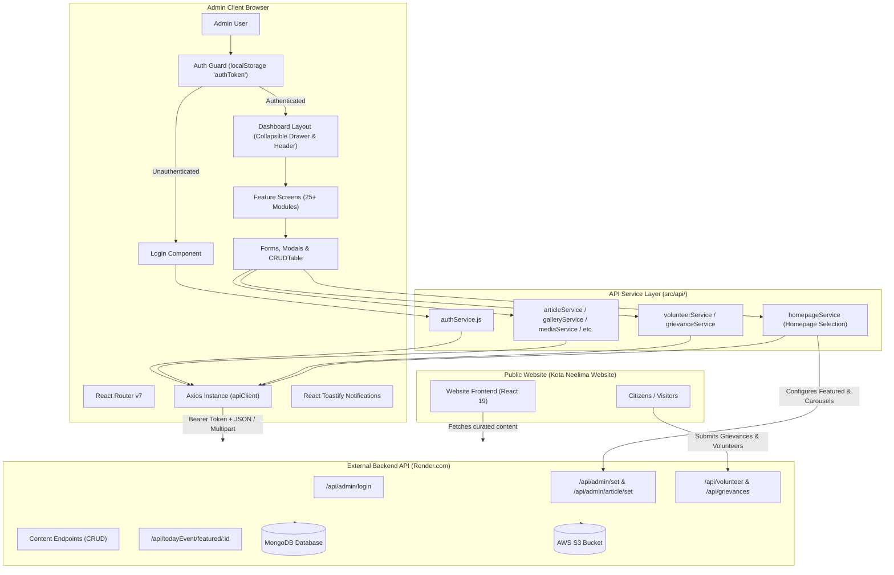
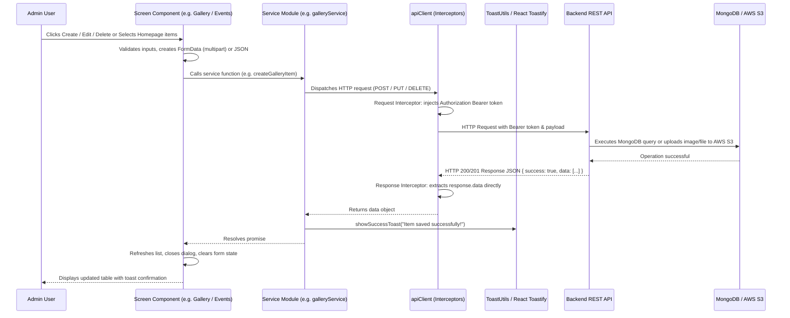
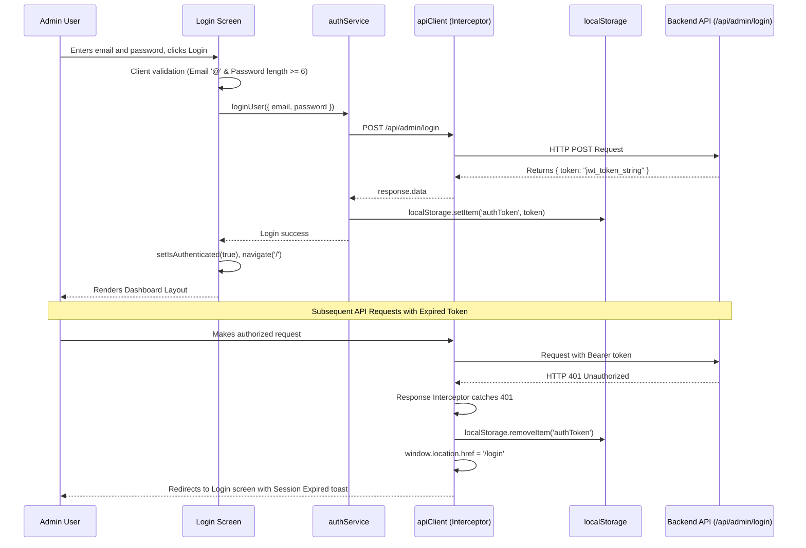

# KOTA NEELIMA CMS - FRONTEND DASHBOARD HANDOFF DOCUMENT

Last Updated: 2026-10-27

---

## TABLE OF CONTENTS

1. [Project Overview](#1-project-overview)
2. [Technology Stack](#2-technology-stack)
3. [Architecture & System Design](#3-architecture--system-design)
4. [Project Structure](#4-project-structure)
5. [Environment Setup](#5-environment-setup)
6. [Configuration & Credentials](#6-configuration--credentials)
7. [Routing & Navigation](#7-routing--navigation)
8. [Authentication & Authorization](#8-authentication--authorization)
9. [State Management](#9-state-management)
10. [API Integration](#10-api-integration)
11. [UI & Component System](#11-ui--component-system)
12. [Forms & Validation](#12-forms--validation)
13. [Payment Integration](#13-payment-integration)
14. [File Handling](#14-file-handling)
15. [Real-Time Features](#15-real-time-features)
16. [Consent & Tracking System](#16-consent--tracking-system)
17. [Error Handling & Notifications](#17-error-handling--notifications)
18. [Performance Optimization](#18-performance-optimization)
19. [Deployment Pipeline](#19-deployment-pipeline)
20. [Testing Strategy](#20-testing-strategy)
21. [Security Considerations](#21-security-considerations)
22. [Troubleshooting Guide](#22-troubleshooting-guide)
23. [Maintenance Checklist](#23-maintenance-checklist)
24. [Adding New Features](#24-adding-new-features)

---

## 1. PROJECT OVERVIEW

### 1.1 Project Name
Kota Neelima Dashboard - Admin Content Management System (Frontend)

### 1.2 Purpose
The Kota Neelima Dashboard is an administrative Content Management System (CMS) designed for Dr. Kota Neelima’s official digital platform. Built with **React 19**, **Vite 7**, and **Material-UI (MUI v7)**, it enables authenticated administrators to manage, curate, and publish all public content displayed on the frontend website. 

The CMS supports full CRUD operations across multiple modules (Gallery, Media, Press, Articles, Hakku Initiative, National Politics, Events, Policy, Rural Distress, Podcasts, and Media Kit Profile), manages public submissions (Citizen Grievances and Volunteer Applications), and provides content selection controls that dictate what appears on the public website's homepage and featured banners.

### 1.3 Key Features & Public Website Correlation

| Module | Description | CRUD Status | Public Website Connection |
|--------|-------------|-------------|---------------------------|
| **Authentication** | Secure JWT-based admin sign-in with password toggle and session interceptor | Auth Only | Protects administrative endpoints |
| **Media Management** | Manage media coverage links, publication dates, and display times | Full CRUD | Feeds the `/media` page on the public portal |
| **Press Management** | Manage press releases, English/Hindi/Telugu titles, dates, and media images | Full CRUD | Feeds the `/press` page on the public portal |
| **Gallery Management** | Manage image galleries with categories, multilingual titles, dates, and times | Full CRUD | Feeds the `/gallery` page and full-screen view |
| **Gallery Category Manager** | Create, edit, and delete photo categories | Full CRUD | Powers the dynamic category filter pills on `/gallery` |
| **Articles** | Publish research articles with descriptions, external URLs, and PDF attachments | Full CRUD | Feeds the `/article` page on the public portal |
| **Homepage Selection (Gallery)** | Select up to 6 gallery photos to be featured on the homepage carousel | Selection (`/api/admin/set`) | Directly controls the homepage gallery carousel on `/` |
| **Homepage Selection (Articles)**| Select up to 2 articles to be highlighted on the homepage | Selection (`/api/admin/article/set`) | Directly controls the homepage featured articles on `/` |
| **Hakku Videos** | Manage Hakku campaign videos with YouTube URLs, dates, and times | Full CRUD | Feeds `/hakku` video grid and modal player |
| **Hakku Press Coverage** | Manage news media coverage of Hakku initiatives with external URLs | Full CRUD | Feeds the `/hakku` press coverage feed |
| **Hakku Press Release** | Manage official Hakku statements, titles, descriptions, and URLs | Full CRUD | Feeds the `/hakku` press release archive |
| **National Politics Gallery** | Manage political photo posts with category selection and bilingual titles | Full CRUD | Feeds the `/national_politics` photo grid |
| **National Politics Categories**| Create, update, and delete political photo categories | Full CRUD | Powers the category filter on `/national_politics` |
| **Today's Events** | Manage event announcements with YouTube links, article links, and dates | Full CRUD | Feeds `/today_events` page on public site |
| **Featured Event Toggle** | Single-click toggle to feature a specific event (`PATCH /featured/:id`) | Feature Toggle | Powers the floating `FeaturedPost` widget on the website |
| **Policy Interventions** | Publish policy intervention whitepapers, descriptions, and source URLs | Full CRUD | Feeds `/policy-interventions` page |
| **Journalism** | Manage investigative journalism publications, write-ups, and URLs | Full CRUD | Feeds `/journalism` archive on public site |
| **Rural Distress: Overview** | Manage core rural distress findings, descriptions, and documentation | Full CRUD | Feeds the "Overview" tab on `/rural-distress` |
| **Rural Distress: Photos** | Upload field photography with titles, dates, and high-res images | Full CRUD | Feeds the "Field Photos" tab on `/rural-distress` |
| **Rural Distress: Conferences** | Manage academic conference records, speaking sessions, and dates | Full CRUD | Feeds the "Conferences" tab on `/rural-distress` |
| **Rural Distress: Books** | Manage books written by Kota Neelima (Cover image, title, author, date) | Full CRUD | Feeds the "Books" showcase on `/rural-distress` |
| **Rural Distress: Articles** | Manage specialized distress research publications with external links | Full CRUD | Feeds the "Articles" tab on `/rural-distress` |
| **Profile: Biography** | Manage author biography in English, Hindi, and Telugu with profile photo | Full CRUD | Feeds the "About / Bio" section on `/profile` |
| **Profile: Photos** | Upload and curate high-resolution press kit photographs for media download | Full CRUD | Feeds the "For Media" photo kit on `/profile` |
| **Profile: Articles** | Manage author press op-eds and media kit articles | Full CRUD | Feeds the "Media Kit Articles" on `/profile` |
| **Podcast Management** | Manage podcast episodes with episode title, date, and streaming URL | Full CRUD | Feeds the homepage podcast section on `/` |
| **Volunteer Management** | Review public volunteer enrollments, search by name/phone, update status | View, Edit Status, Delete | Receives data from public site `/volunteer` form |
| **Grievance Management** | Review citizen grievances, view documents/bills, track resolution status | View, Edit Status, Delete | Receives data from public site `/citizen-grievance` |

### 1.4 Target Audience
- **Primary Administrator**: Dr. Kota Neelima and authorized staff managing public releases, research, and political content.
- **Editorial & Media Coordinators**: Team members responsible for publishing press coverage, photographs, videos, and event schedules.
- **Public Grievance Officers**: Administrative coordinators reviewing submitted constituent grievances and volunteer enrollments.

### 1.5 Current Status

| Area | Status | Notes |
|------|--------|-------|
| **Core Functionality** | Complete | All 25+ administrative screens, modal dialogs, and CRUD actions operational |
| **Authentication** | Complete | JWT token-based admin authentication with automatic 401 redirect |
| **File Uploads** | Complete | Multipart FormData upload to backend S3 integration for images, PDFs, and docs |
| **Website Control** | Complete | Admin controls homepage gallery (max 6), homepage articles (max 2), and featured event |
| **Submission Review** | Complete | Status workflows (`pending`, `in-progress`, `resolved`, `rejected`) for Grievances & Volunteers |
| **Testing** | Missing | No automated unit or integration tests configured |
| **CI/CD** | Missing | Manual deployment to Vercel via Git and Vercel CLI |
| **Documentation** | Complete | This comprehensive handoff document |

### 1.6 Repository Information

| Component | Repository URL |
|-----------|----------------|
| **Admin Dashboard (CMS)** | `https://github.com/kotaneelima123-bit/kota-neelima-dashboard.git` |
| **Public Website (Frontend)**| `https://github.com/kotaneelima123-bit/Kota_Neelima_new_WebSite.git` |

---

## 2. TECHNOLOGY STACK

### 2.1 Core Technologies

| Area | Technology | Version | Purpose |
|------|------------|---------|---------|
| **Framework** | React | 19.1.0 | Core UI library |
| **DOM Renderer** | React DOM | 19.1.0 | Virtual DOM rendering |
| **Build Tool & Bundler** | Vite | 7.0.4 | Fast ES module development server and production bundler |
| **Routing** | React Router | 7.7.1 | Client-side routing, protected layouts, and programmatic navigation |
| **UI Component System** | Material-UI (MUI) | 7.2.0 | Core component library (AppBars, Drawers, Tables, Dialogs, Chips) |
| **Icons** | MUI Icons Material | 7.2.0 | SVG icons (Edit, Delete, Search, Visibility, Menu, Logout) |
| **Date Pickers** | @mui/x-date-pickers | 8.9.0 | Date & Time picker dialogs with localized date formatting |
| **CSS-in-JS Engine** | Emotion (@emotion/react, @emotion/styled) | 11.14.0 / 11.14.1 | Styling engine powering Material-UI custom components |
| **HTTP Client** | Axios | 1.11.0 | Promise-based HTTP client with request and response interceptors |
| **Date Handling** | date-fns | 4.1.0 | Date parsing and timestamp normalization |
| **Toast Notifications** | React Toastify | 11.0.5 | Modern floating toast notification system |

### 2.2 Development Tools

| Tool | Version | Purpose |
|------|---------|---------|
| **ESLint** | 9.30.1 | Modern flat configuration for JavaScript and JSX code quality |
| **ESLint React Plugins**| eslint-plugin-react-hooks / react-refresh | 5.2.0 / 0.4.20 | Enforces React hooks rules and Fast Refresh sanity |
| **Vite React Plugin** | @vitejs/plugin-react | 4.6.0 | Babel-based Fast Refresh during local development |
| **Node.js** | v18+ or v20+ recommended | JavaScript runtime environment |
| **npm** | 9+ | Package and dependency manager |

### 2.3 Complete Dependencies List (`package.json`)

```json
{
  "name": "kota-neelima-dashboard",
  "private": true,
  "version": "0.0.0",
  "type": "module",
  "scripts": {
    "dev": "vite",
    "build": "vite build",
    "lint": "eslint .",
    "preview": "vite preview"
  },
  "dependencies": {
    "@emotion/react": "^11.14.0",
    "@emotion/styled": "^11.14.1",
    "@mui/icons-material": "^7.2.0",
    "@mui/material": "^7.2.0",
    "@mui/x-date-pickers": "^8.9.0",
    "axios": "^1.11.0",
    "date-fns": "^4.1.0",
    "react": "^19.1.0",
    "react-dom": "^19.1.0",
    "react-router": "^7.7.1",
    "react-toastify": "^11.0.5"
  },
  "devDependencies": {
    "@eslint/js": "^9.30.1",
    "@types/react": "^19.1.8",
    "@types/react-dom": "^19.1.6",
    "@vitejs/plugin-react": "^4.6.0",
    "eslint": "^9.30.1",
    "eslint-plugin-react-hooks": "^5.2.0",
    "eslint-plugin-react-refresh": "^0.4.20",
    "globals": "^16.3.0",
    "vite": "^7.0.4"
  }
}
```

---

## 3. ARCHITECTURE & SYSTEM DESIGN

### 3.1 High-Level Architecture



### 3.2 Data Flow Diagram



### 3.3 Authentication & Session Expiry Flow



---

## 4. PROJECT STRUCTURE

### 4.1 Complete Folder Structure

```
kota-neelima-dashboard/
│
├── public/                               # Public static assets
│   ├── img/
│   │   ├── logo.png                      # Official brand header logo
│   │   └── Vector.png                    # Login page artistic illustration vector
│   └── vite.svg
│
├── src/                                  # Source code
│   ├── api/                              # Centralized API Service Layer
│   │   ├── apiClient.js                  # Axios instance with Bearer token & 401 interceptor
│   │   ├── articleService.js             # Research articles CRUD
│   │   ├── authService.js                # Login, logout, and token management
│   │   ├── galleryCategoryService.js     # Gallery photo category management
│   │   ├── galleryService.js             # Gallery posts CRUD
│   │   ├── hakkuPressCoverageService.js  # Hakku press coverage CRUD
│   │   ├── hakkuPressReleaseService.js   # Hakku press release CRUD
│   │   ├── hakkuVideoService.js          # Hakku campaign video CRUD
│   │   ├── homepageService.js            # Homepage item selection (/api/admin/set)
│   │   ├── journalismService.js          # Journalism publications CRUD
│   │   ├── mediaService.js               # Media coverage posts CRUD
│   │   ├── nationalPoliticsService.js    # Politics categories & posts CRUD
│   │   ├── podcastService.js             # Podcasts CRUD
│   │   ├── policyService.js              # Policy intervention proposals CRUD
│   │   ├── pressService.js               # Press release posts CRUD
│   │   ├── profileService.js             # Author Bio, Photos, and Media Kit Articles
│   │   ├── ruralDistressService.js       # Rural distress 5-submodule endpoints
│   │   └── todayEventService.js          # Events CRUD and featured toggle
│   │
│   ├── assets/
│   │   └── react.svg
│   │
│   ├── components/
│   │   ├── auth/                         # Authentication Components
│   │   │   ├── Login.jsx                 # Login form with validation & password reveal
│   │   │   └── login.css                 # Auth layout split-view styling
│   │   │
│   │   ├── common/                       # Shared UI Components
│   │   │   └── CRUDTable.jsx             # Universal data table with pagination & action icons
│   │   │
│   │   └── screens/                      # Administrative Feature Screens
│   │       ├── Article/                  # Research Articles
│   │       │   ├── Article.jsx           # Main screen with Homepage selection modal
│   │       │   ├── ArticleForm.jsx       # Dialog form with PDF upload
│   │       │   └── ArticleTable.jsx      # Paginated articles table
│   │       ├── Gallery/                  # Photo Gallery
│   │       │   ├── CategoryManager.jsx   # Tab for managing photo categories
│   │       │   ├── Gallery.jsx           # Main gallery screen with homepage selection
│   │       │   ├── GalleryForm.jsx       # Multilingual title, image, and category dialog
│   │       │   └── GalleryTable.jsx      # Gallery table with thumbnail preview
│   │       ├── Grievance/                # Citizen Grievance Submissions
│   │       │   ├── GrievanceManagement.jsx # Review, search, status update & doc preview
│   │       │   └── grievanceService.js   # Dedicated API service for grievances
│   │       ├── Hakku/                    # Hakku Initiative Sub-modules
│   │       │   ├── PressCoverage/
│   │       │   │   ├── PressCoverage.jsx
│   │       │   │   ├── PressCoverageForm.jsx
│   │       │   │   └── PressCoverageTable.jsx
│   │       │   ├── PressRelease/
│   │       │   │   ├── PressRelease.jsx
│   │       │   │   ├── PressReleaseForm.jsx
│   │       │   │   └── PressReleaseTable.jsx
│   │       │   └── Videos/
│   │       │       ├── HakkuVideos.jsx
│   │       │       ├── HakkuVideoForm.jsx
│   │       │       └── HakkuVideoTable.jsx
│   │       ├── Journalism/               # Investigative Journalism
│   │       │   ├── Journalism.jsx
│   │       │   ├── JournalismForm.jsx
│   │       │   └── JournalismTable.jsx
│   │       ├── Media/                    # Media Coverage Links
│   │       │   ├── Media.jsx
│   │       │   ├── MediaForm.jsx
│   │       │   └── MediaTable.jsx
│   │       ├── NationalPolitics/         # Political Photo Gallery
│   │       │   ├── CategoryManager.jsx   # Politics category manager
│   │       │   ├── NationalPolitics.jsx  # Tabs for Posts and Categories
│   │       │   ├── PostForm.jsx          # Political post form with category select
│   │       │   ├── PostManager.jsx       # Manager coordinating state and table
│   │       │   └── PostTable.jsx         # Political posts table
│   │       ├── Podcast/                  # Podcasts
│   │       │   ├── Podcast.jsx
│   │       │   ├── PodcastForm.jsx
│   │       │   └── PodcastTable.jsx
│   │       ├── Policy/                   # Policy Interventions
│   │       │   ├── Policy.jsx
│   │       │   ├── PolicyForm.jsx
│   │       │   └── PolicyTable.jsx
│   │       ├── Press/                    # Official Press Releases
│   │       │   ├── Press.jsx
│   │       │   ├── PressForm.jsx
│   │       │   └── PressTable.jsx
│   │       ├── Profile/                  # Media Kit / Author Profile
│   │       │   ├── Articles/
│   │       │   │   ├── ArticleForm.jsx
│   │       │   │   ├── ArticleScreen.jsx
│   │       │   │   └── ArticleTable.jsx
│   │       │   ├── Bio/
│   │       │   │   ├── Bio.jsx
│   │       │   │   ├── BioForm.jsx
│   │       │   │   └── BioTable.jsx
│   │       │   └── Photos/
│   │       │       └── PhotosScreen.jsx  # Media kit photo cards grid with direct upload
│   │       ├── RuralDistress/            # Rural Distress 5 Sub-modules
│   │       │   ├── Article/              # Rural distress articles
│   │       │   │   ├── Article.jsx
│   │       │   │   ├── ArticleForm.jsx
│   │       │   │   └── ArticleTable.jsx
│   │       │   ├── Books/                # Books published by Kota Neelima
│   │       │   │   ├── Books.jsx
│   │       │   │   ├── BooksForm.jsx
│   │       │   │   └── BooksTable.jsx
│   │       │   ├── Conference/           # Speaking conferences
│   │       │   │   ├── Conference.jsx
│   │       │   │   ├── ConferenceForm.jsx
│   │       │   │   └── ConferenceTable.jsx
│   │       │   ├── Photos/               # Field research photography
│   │       │   │   ├── Photos.jsx
│   │       │   │   ├── PhotosForm.jsx
│   │       │   │   └── PhotosTable.jsx
│   │       │   └── Rural_Distress/       # Overview documentation
│   │       │       ├── RuralDistress.jsx
│   │       │       ├── RuralDistressForm.jsx
│   │       │       └── RuralDistressTable.jsx
│   │       ├── TodayEvent/               # Real-time Events & Featured Toggle
│   │       │   ├── TodayEvent.jsx
│   │       │   ├── TodayEventForm.jsx
│   │       │   └── TodayEventTable.jsx
│   │       └── Volunteer/                # Citizen Volunteer Enrollments
│   │           ├── VolunteerManagement.jsx # Review, search, sort & status update
│   │           └── volunteerService.js   # Dedicated API service for volunteers
│   │
│   ├── pages/
│   │   ├── styles/
│   │   │   └── gallery.css               # Gallery screen styling
│   │   ├── DashboardHome.jsx             # Home overview screen with metric cards
│   │   └── DashboardLayout.jsx           # Master layout with responsive sidebar & search
│   │
│   ├── utils/
│   │   └── toastUtils.js                 # React Toastify wrapper (success, error, warning)
│   │
│   ├── App.css                           # Root app CSS
│   ├── App.jsx                           # Route declarations & auth state wrapper
│   ├── index.css                         # Global CSS resets
│   ├── main.jsx                          # React 19 createRoot entry point
│   └── theme.js                          # Material-UI Theme (#76030F primary)
│
├── .env                                  # Environment variables (production & local)
├── .gitignore                            # Git exclusion rules
├── eslint.config.js                      # Flat ESLint 9 configuration
├── index.html                            # HTML entry document
├── package.json                          # Dependencies & scripts
├── package-lock.json                     # Locked dependency tree
├── vercel.json                           # Vercel SPA routing rewrite rules
└── vite.config.js                        # Vite bundler configuration
```

### 4.2 File Naming Conventions

| Component Type | Convention | Example |
|----------------|------------|---------|
| **Screen Wrappers** | PascalCase | `Gallery.jsx`, `TodayEvent.jsx`, `VolunteerManagement.jsx` |
| **Form Dialogs** | ComponentName + `Form.jsx` | `GalleryForm.jsx`, `TodayEventForm.jsx`, `PostForm.jsx` |
| **Data Tables** | ComponentName + `Table.jsx` | `GalleryTable.jsx`, `ArticleTable.jsx`, `PressTable.jsx` |
| **API Services** | camelCase + `Service.js` | `galleryService.js`, `todayEventService.js`, `authService.js` |
| **Utility Modules** | camelCase + `Utils.js` | `toastUtils.js` |
| **CSS Stylesheets** | Match component or camelCase | `login.css`, `gallery.css` |

---

## 5. ENVIRONMENT SETUP

### 5.1 Prerequisites

```bash
# Required software
Node.js: v18.0.0 or later (v20+ LTS recommended)
npm: v9.0.0 or later
Git: Latest version
```

### 5.2 Initial Setup Steps

```bash
# Step 1: Clone the repository
git clone https://github.com/kotaneelima123-bit/kota-neelima-dashboard.git
cd kota-neelima-dashboard

# Step 2: Install dependencies
npm install

# Step 3: Configure .env file
cat > .env << 'EOF'
VITE_API_BASE_URL_DEV=https://kota-neelima-new-bck.onrender.com
VITE_API_BASE_URL_PROD=https://kota-neelima-new-bck.onrender.com
VITE_POLICY_ENDPOINT=/api/proposals
VITE_JOURNALISM_ENDPOINT=/api/journalism
VITE_GALLERY_ENDPOINT=/api/gallery
VITE_MEDIA_ENDPOINT=/api/media
VITE_PRESS_ENDPOINT=/api/press
VITE_ARTICLE_ENDPOINT=/api/article
VITE_HAKKU_ENDPOINT=/api/hakku
VITE_NATIONAL_POLITICS_ENDPOINT=/api/national-politics-gallery
VITE_TODAY_EVENT_ENDPOINT=/api/todayEvent
EOF

# Step 4: Start local development server
npm run dev

# Step 5: Open your browser
# Access the admin dashboard at: http://localhost:5173
```

### 5.3 Available Scripts

| Command | Description |
|---------|-------------|
| `npm run dev` | Runs the Vite development server with Hot Module Replacement (HMR) |
| `npm run build` | Compiles and builds optimized production bundle into the `dist/` directory |
| `npm run preview` | Locally serves the production `dist/` build for pre-deployment testing |
| `npm run lint` | Runs ESLint 9 checks across all JSX/JS files |

### 5.4 Backend Prerequisites
The dashboard requires a running backend server instance providing authentication and database connectivity.
- **Production Backend Endpoint**: `https://kota-neelima-new-bck.onrender.com`
- **Local Backend Endpoint**: `http://localhost:3000` (set in `.env` when debugging local backend code)

---

## 6. CONFIGURATION & CREDENTIALS

### 6.1 Environment Variables

| Variable | Description | Required | Example Value |
|----------|-------------|----------|---------------|
| `VITE_API_BASE_URL_PROD` | Production backend base URL used by Axios | Yes | `https://kota-neelima-new-bck.onrender.com` |
| `VITE_API_BASE_URL_DEV` | Local backend development URL | No | `http://localhost:3000` |
| `VITE_POLICY_ENDPOINT` | Policy interventions API root path | Yes | `/api/proposals` |
| `VITE_JOURNALISM_ENDPOINT` | Investigative journalism API root path | Yes | `/api/journalism` |
| `VITE_GALLERY_ENDPOINT` | Photo gallery API root path | Yes | `/api/gallery` |
| `VITE_MEDIA_ENDPOINT` | Media coverage API root path | Yes | `/api/media` |
| `VITE_PRESS_ENDPOINT` | Press releases API root path | Yes | `/api/press` |
| `VITE_ARTICLE_ENDPOINT` | Articles & research publications API root path | Yes | `/api/article` |
| `VITE_HAKKU_ENDPOINT` | Hakku initiative API root path | Yes | `/api/hakku` |
| `VITE_NATIONAL_POLITICS_ENDPOINT` | National politics gallery API root path | Yes | `/api/national-politics-gallery` |
| `VITE_TODAY_EVENT_ENDPOINT` | Today's events API root path | Yes | `/api/todayEvent` |

### 6.2 Important Configuration Notes
- Environment variables exposed to client-side code must start with `VITE_`.
- `apiClient.js` references `import.meta.env.VITE_API_BASE_URL_PROD` by default.
- Never commit actual secrets or credential tokens into Git. `.env` is ignored by `.gitignore`.
- Restart the Vite development server whenever changes are made to `.env`.

---

## 7. ROUTING & NAVIGATION

### 7.1 Route Structure (`src/App.jsx`)

| Path | Component | Auth Required | Description |
|------|-----------|---------------|-------------|
| `/login` | `Login` | Public | Admin login screen (redirects to `/` if authenticated) |
| `/` | `DashboardLayout` | **Protected** | Master layout with sidebar drawer and header |
| `/` (index) | `DashboardHome` | **Protected** | Welcome overview and quick stat metric cards |
| `/media` | `Media` | **Protected** | Manage media coverage links, dates, and times |
| `/gallery` | `Gallery` | **Protected** | Manage photo gallery and Homepage Gallery Selection (Max 6) |
| `/press` | `Press` | **Protected** | Manage official press releases and bilingual titles |
| `/article` | `Article` | **Protected** | Manage articles and Homepage Article Selection (Max 2) |
| `/hakku/videos` | `HakkuVideos` | **Protected** | Manage Hakku campaign videos |
| `/hakku/press_coverage` | `PressCoverage` | **Protected** | Manage Hakku press coverage links |
| `/hakku/press_release` | `PressRelease` | **Protected** | Manage official Hakku statements |
| `/national_politics` | `NationalPolitics` | **Protected** | Political photo posts and category management |
| `/today_events` | `TodayEvent` | **Protected** | Events feed with single-click Featured Toggle |
| `/policy-interventions` | `Policy` | **Protected** | Policy proposals and whitepaper publications |
| `/journalism` | `Journalism` | **Protected** | Investigative journalism articles |
| `/rural-distress` | `RuralDistress` | **Protected** | Rural distress core findings and documentation |
| `/rural-distress/photos`| `Photos` | **Protected** | Rural distress field photography gallery |
| `/rural-distress/conference`| `Conference` | **Protected** | Academic conferences and speaking engagements |
| `/rural-distress/books` | `Books` | **Protected** | Books published by Kota Neelima |
| `/rural-distress/articles`| `RuralArticle` | **Protected** | Specialized rural distress research articles |
| `/profile/bio` | `BioScreen` | **Protected** | Author biography (EN/HI/TE) and profile photo |
| `/profile/photos` | `PhotosScreen` | **Protected** | High-res downloadable media kit photos |
| `/profile/articles` | `ArticleScreen` | **Protected** | Author press kit articles |
| `/podcast` | `Podcast` | **Protected** | Podcast episodes and streaming URLs |
| `/volunteer` | `VolunteerManagement` | **Protected** | Review volunteer applications from public website |
| `/grievance` | `GrievanceManagement` | **Protected** | Review citizen grievances, view documents & update status |
| `*` (Catch-all) | Redirect | N/A | Redirects to `/` (if logged in) or `/login` |

### 7.2 Route Protection Implementation

```jsx
// src/App.jsx
import { useState } from 'react';
import { BrowserRouter, Routes, Route, Navigate } from "react-router";

function App() {
  const [isAuthenticated, setIsAuthenticated] = useState(
    localStorage.getItem('authToken') !== null
  );

  return (
    <BrowserRouter>
      <Routes>
        <Route
          path="/login"
          element={!isAuthenticated ?
            <Login setIsAuthenticated={setIsAuthenticated} /> :
            <Navigate to="/" replace />}
        />

        <Route
          path="/"
          element={isAuthenticated ?
            <DashboardLayout setIsAuthenticated={setIsAuthenticated} /> :
            <Navigate to="/login" replace />}
        >
          <Route index element={<DashboardHome />} />
          <Route path="media" element={<Media />} />
          <Route path="gallery" element={<Gallery />} />
          <Route path="press" element={<Press />} />
          <Route path="article" element={<Article />} />
          <Route path="hakku/videos" element={<HakkuVideos />} />
          <Route path="hakku/press_coverage" element={<PressCoverage />} />
          <Route path="hakku/press_release" element={<PressRelease />} />
          <Route path="national_politics" element={<NationalPolitics />} />
          <Route path="today_events" element={<TodayEvent />} />
          <Route path="policy-interventions" element={<Policy />} />
          <Route path="journalism" element={<Journalism />} />
          <Route path="rural-distress" element={<RuralDistress />} />
          <Route path="rural-distress/photos" element={<Photos />} />
          <Route path="rural-distress/conference" element={<Conference />} />
          <Route path="rural-distress/books" element={<Books />} />
          <Route path="rural-distress/articles" element={<RuralArticle />} />
          <Route path="profile/bio" element={<BioScreen />} />
          <Route path="profile/photos" element={<PhotosScreen />} />
          <Route path="profile/articles" element={<ArticleScreen />} />
          <Route path="podcast" element={<Podcast />} />
          <Route path="volunteer" element={<VolunteerManagement />} />
          <Route path="grievance" element={<GrievanceManagement />} />
        </Route>

        <Route path="*" element={<Navigate to={isAuthenticated ? "/" : "/login"} replace />} />
      </Routes>
    </BrowserRouter>
  );
}
```

---

## 8. AUTHENTICATION & AUTHORIZATION

### 8.1 Login Implementation (`src/components/auth/Login.jsx`)
The authentication screen validates user credentials client-side before dispatching `POST /api/admin/login`:
- Email validation: Checks for valid `@` symbol presence.
- Password validation: Enforces minimum length of 6 characters.
- Visibility Toggle: Allows showing/hiding password using MUI `Visibility` / `VisibilityOff` icons.
- Token Storage: On HTTP 200, saves token to `localStorage.setItem('authToken', response.token)` and updates application state.

### 8.2 Axios Auth Interceptors (`src/api/apiClient.js`)

```javascript
import axios from 'axios';
import { showErrorToast } from '../utils/toastUtils';

const baseURL = import.meta.env.VITE_API_BASE_URL_PROD;

const apiClient = axios.create({
  baseURL: baseURL,
  headers: {
    'Content-Type': 'application/json',
  },
});

// Request Interceptor: Automatically attaches Bearer token to all outgoing requests
apiClient.interceptors.request.use(
  (config) => {
    const token = localStorage.getItem('authToken');
    if (token) {
      config.headers['Authorization'] = `Bearer ${token}`;
    }
    return config;
  },
  (error) => {
    showErrorToast('Network error. Please check your connection.');
    return Promise.reject(error);
  }
);

// Response Interceptor: Unwraps response.data and intercepts 401 Session Expiration
apiClient.interceptors.response.use(
  (response) => response.data,
  (error) => {
    const { response } = error;
    let errorMessage = 'An unexpected error occurred';

    if (response) {
      switch (response.status) {
        case 400:
          errorMessage = response.data.message || 'Invalid request';
          break;
        case 401:
          errorMessage = 'Session expired. Please login again.';
          localStorage.removeItem('authToken');
          window.location.href = '/login';
          break;
        case 403:
          errorMessage = 'You are not authorized to perform this action';
          break;
        case 404:
          errorMessage = 'Resource not found';
          break;
        case 500:
          errorMessage = 'Server error. Please try again later.';
          break;
        default:
          errorMessage = response.data.message || error.message;
      }
    } else if (error.message === 'Network Error') {
      errorMessage = 'Network error. Please check your internet connection.';
    }

    showErrorToast(errorMessage);
    return Promise.reject(errorMessage);
  }
);

export default apiClient;
```

### 8.3 Security Notes & Recommendations

| Aspect | Current Implementation | Production Recommendation |
|--------|------------------------|---------------------------|
| **Token Storage** | `localStorage.getItem('authToken')` | Migrate to secure, `httpOnly`, `SameSite=Strict` cookies to eliminate XSS token theft |
| **Token Expiry** | Passive (Triggered on 401 response) | Decode JWT payload client-side to check `exp` and prompt proactive session refresh |
| **Route Protection** | Client-side React state | Server-side validation on every API endpoint (Backend enforced) |
| **Rate Limiting** | None | Enforce IP-based rate limiting on `/api/admin/login` (e.g. 5 attempts / 15 mins) |

---

## 9. STATE MANAGEMENT

### 9.1 Current Approach
The dashboard adopts a lightweight local state management architecture using React’s built-in `useState` and `useEffect` hooks. Because each dashboard module is self-contained (Media, Gallery, Events, Grievances), there is no need for heavy global state stores like Redux or MobX.

### 9.2 State Patterns

| State Type | Purpose | Typical Variable Names |
|------------|---------|------------------------|
| **Form State** | Stores controlled form inputs for create/edit operations | `formData`, `editFormData` |
| **Table Data State** | Stores list of items returned from backend API | `items`, `galleryItems`, `events`, `volunteers` |
| **Dialog Visibility** | Controls visibility of Create/Edit modal dialogs | `formOpen`, `openEditDialog`, `openViewDialog` |
| **Loading State** | Controls spinner overlay during async calls | `loading`, `formLoading`, `actionLoading` |
| **Pagination State** | Tracks active page number and rows per page | `page`, `rowsPerPage`, `itemsPerPage` |
| **Selection State** | Stores IDs of items selected for Homepage display | `selectedItems` (Max 6 for Gallery, Max 2 for Articles) |
| **Feedback State** | Controls Material-UI Snackbars and Confirmation alerts | `snackbar`, `confirmDialog` |

### 9.3 Typical Component State Example (`Gallery.jsx`)

```jsx
const [formData, setFormData] = useState({
  title: '',
  hindiTitle: '',
  teluguTitle: '',
  date: null,
  time: null,
  image: null,
  categoryId: ''
});
const [currentItem, setCurrentItem] = useState(null);
const [galleryItems, setGalleryItems] = useState([]);
const [categories, setCategories] = useState([]);
const [selectedItems, setSelectedItems] = useState([]); // Homepage selection IDs
const [loading, setLoading] = useState(false);
const [saving, setSaving] = useState(false);
const [page, setPage] = useState(1);
const [snackbar, setSnackbar] = useState({ open: false, message: '', severity: 'success' });
const [confirmDialog, setConfirmDialog] = useState({ open: false });
const [activeTab, setActiveTab] = useState(0);
```

---

## 10. API INTEGRATION

### 10.1 Service Modules List & Full Endpoint Matrix

All CRUD services import the pre-configured `apiClient` instance and dispatch HTTP operations. Below is the complete matrix of all service endpoints across the dashboard:

| Service Module | Method | Endpoint | Payload / Format | Purpose |
|----------------|--------|----------|------------------|---------|
| `authService.js` | POST | `/api/admin/login` | `{ email, password }` | Authenticates administrator, returns JWT |
| `homepageService.js` | POST | `/api/admin/set` | `{ galleryItems: [...] }` | Sets homepage gallery items (Max 6) |
| `homepageService.js` | GET | `/api/admin/get` | None | Retrieves homepage gallery item selection |
| `homepageService.js` | POST | `/api/admin/article/set`| `{ galleryItems: [...] }` | Sets homepage article items (Max 2) |
| `homepageService.js` | GET | `/api/admin/article/get`| None | Retrieves homepage article selection |
| `galleryService.js` | GET | `/api/gallery/posts` | None | Fetches all gallery photos |
| `galleryService.js` | POST | `/api/gallery/create/post` | `FormData` (title, image, categoryId, etc.) | Creates new gallery item with image |
| `galleryService.js` | PUT | `/api/gallery/update/post/:id` | `FormData` (title, image, categoryId, etc.) | Updates gallery photo item |
| `galleryService.js` | DELETE | `/api/gallery/delete/post/:id` | None | Deletes gallery photo |
| `galleryCategoryService.js` | GET | `/api/gallery-category/all` | None | Retrieves all photo categories |
| `galleryCategoryService.js` | POST | `/api/gallery-category/create` | `{ name: string }` | Creates photo category |
| `galleryCategoryService.js` | PUT | `/api/gallery-category/update/:id` | `{ name: string }` | Renames photo category |
| `galleryCategoryService.js` | DELETE | `/api/gallery-category/delete/:id` | None | Deletes photo category |
| `mediaService.js` | GET | `/api/media/post` | None | Fetches all media coverage links |
| `mediaService.js` | POST | `/api/media/post` | `{ url, date, time }` | Creates media post |
| `mediaService.js` | PUT | `/api/media/post/:id` | `{ url, date, time }` | Updates media post |
| `mediaService.js` | DELETE | `/api/media/post/:id` | None | Deletes media post |
| `pressService.js` | GET | `/api/press/posts` | None | Fetches all press release items |
| `pressService.js` | POST | `/api/press/create/post` | `FormData` (title, url, date, image) | Creates press release |
| `pressService.js` | PUT | `/api/press/update/post/:id` | `FormData` (title, url, date, image) | Updates press release |
| `pressService.js` | DELETE | `/api/press/delete/post/:id` | None | Deletes press release |
| `articleService.js` | GET | `/api/article/articles` | None | Fetches all research articles |
| `articleService.js` | POST | `/api/article/create` | `FormData` (title, url, pdf, date) | Creates article with PDF upload |
| `articleService.js` | PUT | `/api/article/:id` | `FormData` (title, url, pdf, date) | Updates article |
| `articleService.js` | DELETE | `/api/article/:id` | None | Deletes research article |
| `todayEventService.js` | GET | `/api/todayEvent/all` | None | Fetches all today's events |
| `todayEventService.js` | POST | `/api/todayEvent/create` | `FormData` (title, videoUrl, date, image) | Creates event announcement |
| `todayEventService.js` | PUT | `/api/todayEvent/:id` | `FormData` (title, videoUrl, date, image) | Updates event announcement |
| `todayEventService.js` | DELETE | `/api/todayEvent/:id` | None | Deletes event announcement |
| `todayEventService.js` | PATCH | `/api/todayEvent/featured/:id` | `{ featured: boolean }` | Toggles featured status for website widget |
| `todayEventService.js` | GET | `/api/todayEvent/featured` | None | Fetches currently featured event |
| `nationalPoliticsService.js`| GET | `/api/national-politics-gallery/categories` | None | Fetches politics categories |
| `nationalPoliticsService.js`| POST | `/api/national-politics-gallery/categories` | `{ name: string }` | Creates politics category |
| `nationalPoliticsService.js`| PUT | `/api/national-politics-gallery/update/category/:id` | `{ name: string }` | Updates politics category name |
| `nationalPoliticsService.js`| DELETE| `/api/national-politics-gallery/categories/:id` | None | Deletes politics category |
| `nationalPoliticsService.js`| GET | `/api/national-politics-gallery/gallery` | None | Fetches political photo posts |
| `nationalPoliticsService.js`| POST | `/api/national-politics-gallery/gallery` | `FormData` (title, image, categoryId) | Creates political photo post |
| `nationalPoliticsService.js`| PUT | `/api/national-politics-gallery/gallery/:id` | `FormData` (title, image, categoryId) | Updates political photo post |
| `nationalPoliticsService.js`| DELETE| `/api/national-politics-gallery/gallery/:id` | None | Deletes political photo post |
| `hakkuVideoService.js` | GET | `/api/hakku/all` | None | Fetches Hakku campaign videos |
| `hakkuVideoService.js` | POST | `/api/hakku/create` | `{ url, date, time }` | Creates Hakku video |
| `hakkuVideoService.js` | PUT | `/api/hakku/update/:id` | `{ url, date, time }` | Updates Hakku video |
| `hakkuVideoService.js` | DELETE | `/api/hakku/delete/:id` | None | Deletes Hakku video |
| `hakkuPressCoverageService.js`| GET| `/api/hakku/press-coverage/all` | None | Fetches Hakku press coverage |
| `hakkuPressCoverageService.js`| POST| `/api/hakku/press-coverage/create` | `{ title, url }` | Creates Hakku press coverage |
| `hakkuPressCoverageService.js`| PUT| `/api/hakku/press-coverage/update/:id` | `{ title, url }` | Updates Hakku press coverage |
| `hakkuPressCoverageService.js`| DELETE| `/api/hakku/press-coverage/delete/:id` | None | Deletes Hakku press coverage |
| `hakkuPressReleaseService.js`| GET| `/api/hakku/press-release/all` | None | Fetches Hakku press releases |
| `hakkuPressReleaseService.js`| POST| `/api/hakku/press-release/create` | `FormData` / `{ title, url, desc }` | Creates Hakku press release |
| `hakkuPressReleaseService.js`| PUT| `/api/hakku/press-release/update/:id` | `FormData` / `{ title, url, desc }` | Updates Hakku press release |
| `hakkuPressReleaseService.js`| DELETE| `/api/hakku/press-release/delete/:id` | None | Deletes Hakku press release |
| `policyService.js` | GET | `/api/proposals/all` | None | Fetches policy interventions |
| `policyService.js` | POST | `/api/proposals/post` | `{ title, description, url }` | Creates policy intervention |
| `policyService.js` | PUT | `/api/proposals/update/:id` | `{ title, description, url }` | Updates policy intervention |
| `policyService.js` | DELETE | `/api/proposals/delete/:id` | None | Deletes policy intervention |
| `journalismService.js` | GET | `/api/journalism/all` | None | Fetches journalism publications |
| `journalismService.js` | POST | `/api/journalism/create` | `{ title, description, url }` | Creates journalism publication |
| `journalismService.js` | PUT | `/api/journalism/:id` | `{ title, description, url }` | Updates journalism publication |
| `journalismService.js` | DELETE | `/api/journalism/:id` | None | Deletes journalism publication |
| `podcastService.js` | GET | `/api/podcast/all` | None | Fetches all podcasts |
| `podcastService.js` | POST | `/api/podcast/create` | `{ title, date, url }` | Creates podcast episode |
| `podcastService.js` | PUT | `/api/podcast/:id` | `{ title, date, url }` | Updates podcast episode |
| `podcastService.js` | DELETE | `/api/podcast/:id` | None | Deletes podcast episode |
| `ruralDistressService.js` | GET | `/api/rural-distress/all` | None | Fetches overview entries |
| `ruralDistressService.js` | POST | `/api/rural-distress/create` | `{ description, date }` | Creates overview entry |
| `ruralDistressService.js` | PUT | `/api/rural-distress/:id` | `{ description, date }` | Updates overview entry |
| `ruralDistressService.js` | DELETE | `/api/rural-distress/:id` | None | Deletes overview entry |
| `ruralDistressService.js` | GET | `/api/rural-distress/photos/all` | None | Fetches field photos |
| `ruralDistressService.js` | POST | `/api/rural-distress/photos/create` | `FormData` (title, image, date) | Uploads field photo |
| `ruralDistressService.js` | PUT | `/api/rural-distress/photos/:id` | `FormData` (title, image, date) | Updates field photo |
| `ruralDistressService.js` | DELETE | `/api/rural-distress/photos/:id` | None | Deletes field photo |
| `ruralDistressService.js` | GET | `/api/rural-distress/conferences/all` | None | Fetches conference entries |
| `ruralDistressService.js` | POST | `/api/rural-distress/conferences/create` | `{ description, date }` | Creates conference entry |
| `ruralDistressService.js` | PUT | `/api/rural-distress/conferences/:id` | `{ description, date }` | Updates conference entry |
| `ruralDistressService.js` | DELETE | `/api/rural-distress/conferences/:id` | None | Deletes conference entry |
| `ruralDistressService.js` | GET | `/api/rural-distress/books/all` | None | Fetches books list |
| `ruralDistressService.js` | POST | `/api/rural-distress/books/create` | `FormData` (title, bookImage, date) | Creates book record |
| `ruralDistressService.js` | PUT | `/api/rural-distress/books/:id` | `FormData` (title, bookImage, date) | Updates book record |
| `ruralDistressService.js` | DELETE | `/api/rural-distress/books/:id` | None | Deletes book record |
| `ruralDistressService.js` | GET | `/api/rural-distress/articles/all` | None | Fetches rural distress articles |
| `ruralDistressService.js` | POST | `/api/rural-distress/article/create` | `{ title, description, url, date }` | Creates distress article |
| `ruralDistressService.js` | PUT | `/api/rural-distress/article/:id` | `{ title, description, url, date }` | Updates distress article |
| `ruralDistressService.js` | DELETE | `/api/rural-distress/article/:id` | None | Deletes distress article |
| `profileService.js` | GET | `/profile/bio/all` | None | Fetches author bio details |
| `profileService.js` | POST | `/profile/bio/create` | `FormData` (bio descriptions, photo) | Creates author bio |
| `profileService.js` | PUT | `/profile/bio/:id` | `FormData` (bio descriptions, photo) | Updates author bio |
| `profileService.js` | DELETE | `/profile/bio/:id` | None | Deletes author bio |
| `profileService.js` | GET | `/profile/photos/all` | None | Fetches press kit photos |
| `profileService.js` | POST | `/profile/photos/upload` | `FormData` (photo file) | Uploads press kit photo |
| `profileService.js` | DELETE | `/profile/photos/:id` | None | Deletes press kit photo |
| `profileService.js` | GET | `/profile/articles/all` | None | Fetches media kit articles |
| `profileService.js` | POST | `/profile/articles/create` | `{ title, description, url }` | Creates media kit article |
| `profileService.js` | PUT | `/profile/articles/:id` | `{ title, description, url }` | Updates media kit article |
| `profileService.js` | DELETE | `/profile/articles/:id` | None | Deletes media kit article |
| `volunteerService.js` | GET | `/api/volunteer/all` | None | Fetches all volunteer submissions |
| `volunteerService.js` | GET | `/api/volunteer/:id` | None | Fetches single volunteer detail |
| `volunteerService.js` | PUT | `/api/volunteer/update/:id` | `{ status, notes, ... }` | Updates volunteer status |
| `volunteerService.js` | DELETE | `/api/volunteer/delete/:id` | None | Deletes volunteer submission |
| `grievanceService.js` | GET | `/api/grievances/all` | None | Fetches all citizen grievances |
| `grievanceService.js` | GET | `/api/grievances/:id` | None | Fetches single grievance with doc |
| `grievanceService.js` | PUT | `/api/grievances/update/:id` | `FormData` / `{ status, ... }` | Updates grievance status & notes |
| `grievanceService.js` | DELETE | `/api/grievances/delete/:id` | None | Deletes citizen grievance |

---

## 11. UI & COMPONENT SYSTEM

### 11.1 Theme Configuration (`src/theme.js`)
The dashboard uses Material-UI theming with Dr. Kota Neelima's signature deep maroon brand color:

```javascript
// src/theme.js
import { createTheme } from '@mui/material/styles';

const theme = createTheme({
  palette: {
    primary: {
      main: '#76030F', // Brand Maroon
    },
  },
  components: {
    MuiButton: {
      styleOverrides: {
        root: {
          textTransform: 'none', // Disables default uppercase button text
        },
      },
    },
  },
});

export default theme;
```

### 11.2 Dashboard Layout (`src/pages/DashboardLayout.jsx`)
The main layout manages responsive desktop/mobile navigation:
- **Collapsible Sidebar Drawer (240px)**: Permanent on desktop (`sm` and above), temporary sliding overlay on mobile viewports.
- **Accordion Nested Menus**: Multi-level navigation for sub-modules:
  - *Hakku Initiative*: Videos, Press Coverage, Press Release.
  - *Rural Distress*: Rural Distress, Photos, Conference, Books, Articles.
  - *Profile*: Bio, Photos, Articles.
- **Top Navigation Bar (AppBar)**: Fixed white header with search input, user avatar, and mobile hamburger trigger.
- **Logout Action**: Clears `localStorage.getItem('authToken')` and sets `setIsAuthenticated(false)`.

### 11.3 Universal Data Table (`src/components/common/CRUDTable.jsx`)
The universal table component standardizes data presentation across modules:

```jsx
// src/components/common/CRUDTable.jsx
import React from 'react';
import {
  Table, TableBody, TableCell, TableContainer, TableHead, TableRow,
  Paper, CircularProgress, Pagination, Stack, IconButton
} from '@mui/material';
import { Edit as EditIcon, Delete as DeleteIcon } from '@mui/icons-material';

const CRUDTable = ({
  columns,
  data,
  loading,
  page,
  itemsPerPage,
  totalItems,
  onPageChange,
  onEdit,
  onDelete,
}) => {
  return (
    <Paper elevation={0} sx={{ p: 3, backgroundColor: 'white', borderRadius: '8px' }}>
      <TableContainer>
        <Table>
          <TableHead>
            <TableRow sx={{ backgroundColor: '#f4f6f8' }}>
              {columns.map((column) => (
                <TableCell key={column.field} sx={{ fontWeight: 600 }}>
                  {column.headerName}
                </TableCell>
              ))}
              {(onEdit || onDelete) && <TableCell sx={{ fontWeight: 600 }}>Actions</TableCell>}
            </TableRow>
          </TableHead>
          <TableBody>
            {loading ? (
              <TableRow>
                <TableCell colSpan={columns.length + 1} align="center">
                  <CircularProgress />
                </TableCell>
              </TableRow>
            ) : data.length > 0 ? (
              data.map((row) => (
                <TableRow key={row._id} hover>
                  {columns.map((column) => (
                    <TableCell key={`${row._id}-${column.field}`}>
                      {column.render ? column.render(row) : row[column.field]}
                    </TableCell>
                  ))}
                  {(onEdit || onDelete) && (
                    <TableCell>
                      {onEdit && (
                        <IconButton onClick={() => onEdit(row)} sx={{ color: '#637381' }}>
                          <EditIcon />
                        </IconButton>
                      )}
                      {onDelete && (
                        <IconButton onClick={() => onDelete(row)} sx={{ color: '#637381' }}>
                          <DeleteIcon />
                        </IconButton>
                      )}
                    </TableCell>
                  )}
                </TableRow>
              ))
            ) : (
              <TableRow>
                <TableCell colSpan={columns.length + 1} align="center">
                  No items found
                </TableCell>
              </TableRow>
            )}
          </TableBody>
        </Table>
      </TableContainer>

      {totalItems > itemsPerPage && (
        <Stack spacing={2} sx={{ mt: 3, alignItems: 'center' }}>
          <Pagination
            count={Math.ceil(totalItems / itemsPerPage)}
            page={page}
            onChange={onPageChange}
            shape="rounded"
            sx={{
              '& .MuiPaginationItem-root.Mui-selected': {
                backgroundColor: '#76030F',
                color: 'white',
                '&:hover': { backgroundColor: '#5a020c' },
              },
            }}
          />
        </Stack>
      )}
    </Paper>
  );
};

export default CRUDTable;
```

---

## 12. FORMS & VALIDATION

### 12.1 Form Implementation Overview
Forms are implemented as controlled components inside Material-UI `Dialog` modals. State changes are handled through standard `onChange` callbacks, and dates are captured using `@mui/x-date-pickers/DatePicker`.

### 12.2 Multilingual Content Form Pattern
Modules requiring English, Hindi, and Telugu support (e.g. Gallery, Press, Events, Bio) use multiple title and description fields:

```jsx
// Multilingual form pattern in GalleryForm.jsx & TodayEventForm.jsx
<TextField
  fullWidth
  label="Title (English)"
  name="title"
  value={formData.title}
  onChange={handleChange}
  required
  margin="normal"
/>

<TextField
  fullWidth
  label="Title (Hindi)"
  name="hindiTitle"
  value={formData.hindiTitle}
  onChange={handleChange}
  margin="normal"
/>

<TextField
  fullWidth
  label="Title (Telugu)"
  name="teluguTitle"
  value={formData.teluguTitle}
  onChange={handleChange}
  margin="normal"
/>
```

### 12.3 Date & Time Handling Pattern

```jsx
import { LocalizationProvider } from '@mui/x-date-pickers/LocalizationProvider';
import { AdapterDateFns } from '@mui/x-date-pickers/AdapterDateFns';
import { DatePicker } from '@mui/x-date-pickers/DatePicker';

<LocalizationProvider dateAdapter={AdapterDateFns}>
  <DatePicker
    label="Event Date"
    value={formData.date ? new Date(formData.date) : null}
    onChange={(newDate) => setFormData(prev => ({ ...prev, date: newDate }))}
    renderInput={(params) => <TextField {...params} fullWidth margin="normal" />}
  />
</LocalizationProvider>
```

---

## 13. PAYMENT INTEGRATION

### 13.1 Status
- **Not Implemented / Not Applicable**: The Kota Neelima Dashboard is an administrative content management portal. No customer payments, donations, or checkout gateways are required or implemented in this repository.

---

## 14. FILE HANDLING

### 14.1 Multipart File Uploads
Files (photographs, books covers, PDFs, and grievance attachments) are packaged into native `FormData` objects and transmitted with `headers: { 'Content-Type': 'multipart/form-data' }`.

```javascript
// Generic upload pattern used across galleryService, articleService, profileService
export const createGalleryItem = async (formData) => {
  const data = new FormData();
  Object.entries(formData).forEach(([key, value]) => {
    if (value !== null && value !== undefined) {
      data.append(key, value);
    }
  });

  return await apiClient.post(`${GALLERY_ENDPOINT}/create/post`, data, {
    headers: { 'Content-Type': 'multipart/form-data' },
  });
};
```

### 14.2 File Preview & Inspection
- **Image Previews**: Form components generate local preview URLs using `URL.createObjectURL(file)` before submission.
- **Document Inspection (Grievances)**: In `GrievanceManagement.jsx`, admins can click uploaded documents to view or download citizen attachments (electricity bills, petitions, photographs).

```jsx
// Document preview in GrievanceManagement.jsx
{grievance.document && (
  <DocumentPreview onClick={() => window.open(grievance.document, '_blank')}>
    {grievance.document.match(/\.(jpg|jpeg|png|webp)$/i) ? (
      <ImageIcon sx={{ color: '#76030F' }} />
    ) : (
      <DocumentIcon sx={{ color: '#76030F' }} />
    )}
    <Typography variant="body2" sx={{ color: '#76030F', fontWeight: 500 }}>
      View Attached Document
    </Typography>
  </DocumentPreview>
)}
```

### 14.3 File Types Supported

| File Type | Modules | Form Field | Maximum Size |
|-----------|---------|------------|--------------|
| **Images** (`.jpg`, `.jpeg`, `.png`, `.webp`) | Gallery, Press, Politics, Events, Rural Photos, Books, Profile | `image`, `bookImage`, `profileImage` | Up to 10 MB |
| **PDF Documents** (`.pdf`) | Articles, Hakku Releases, Policy | `pdf` | Up to 25 MB |
| **Citizen Supporting Docs** | Grievances | `document` | Up to 5 MB |

---

## 15. REAL-TIME FEATURES

### 15.1 Status
- **Not Implemented**: The dashboard uses on-demand REST HTTP communication without WebSocket or SSE listeners.
- **Operational Reality**: When new grievances or volunteer submissions are made on the public website, the administrator reloads the table or switches tabs to view updated lists.

---

## 16. CONSENT & TRACKING SYSTEM

### 16.1 Status
- **Not Implemented / Not Applicable**: The dashboard is an internal administrative back-office tool. No end-user marketing pixels, cookie consent banners, or telemetry scripts are bundled.

---

## 17. ERROR HANDLING & NOTIFICATIONS

### 17.1 Toast Notifications (`src/utils/toastUtils.js`)
The application wraps `react-toastify` into standardized notification utilities:

```javascript
// src/utils/toastUtils.js
import { toast } from 'react-toastify';
import 'react-toastify/dist/ReactToastify.css';

export const showSuccessToast = (message) => {
  toast.success(message, {
    position: 'top-right',
    autoClose: 5000,
    hideProgressBar: false,
    closeOnClick: true,
    pauseOnHover: true,
    draggable: true,
  });
};

export const showErrorToast = (message) => {
  toast.error(message, {
    position: 'top-right',
    autoClose: 5000,
    hideProgressBar: false,
    closeOnClick: true,
    pauseOnHover: true,
    draggable: true,
  });
};

export const showWarningToast = (message) => {
  toast.warning(message, {
    position: 'top-right',
    autoClose: 5000,
    hideProgressBar: false,
    closeOnClick: true,
    pauseOnHover: true,
    draggable: true,
  });
};
```

### 17.2 Confirmation Dialogs & Destructive Action Safeguards
All delete actions trigger a secondary Material-UI confirmation modal (`Dialog`) asking the user to confirm deletion before dispatching the HTTP DELETE request, preventing accidental data loss.

---

## 18. PERFORMANCE OPTIMIZATION

### 18.1 Current Optimizations

| Technique | Implementation Details |
|-----------|------------------------|
| **Vite 7 Fast Bundling** | Near-instant HMR during development and tree-shaken Rollup production builds |
| **Client-Side Pagination** | Limits rendered table rows (5 or 10 rows per page) to prevent DOM bloat |
| **Emotion Style Caching** | Cached CSS-in-JS style rules prevent unnecessary recalculations on re-render |
| **Selective Data Unwrapping**| Axios interceptor strips HTTP metadata, delivering sanitized JSON payloads directly to components |

### 18.2 Recommendations
- **Route Lazy-Loading**: Wrap screen components in `React.lazy()` and `Suspense` inside `App.jsx` to eliminate initial bundle latency.
- **Server-Side Pagination**: Currently, tables fetch all records and paginate in memory. Migrate large collections (e.g. Grievances and Volunteers) to server-side query parameters (`?page=1&limit=10`).

---

## 19. DEPLOYMENT PIPELINE

### 19.1 Vercel Configuration (`vercel.json`)
The application is pre-configured for Vercel Single Page Application (SPA) deployment:

```json
{
  "rewrites": [
    {
      "source": "/(.*)",
      "destination": "/index.html"
    }
  ]
}
```

### 19.2 Build & Manual Deployment Commands

```bash
# Step 1: Create production bundle
npm run build

# Step 2: Test production bundle locally
npm run preview

# Step 3: Deploy directly to production via Vercel CLI
vercel --prod
```

### 19.3 Production Environment Variables Setup
When deploying to Vercel or Netlify, configure the following variables in the hosting dashboard:
```
VITE_API_BASE_URL_PROD=https://kota-neelima-new-bck.onrender.com
VITE_POLICY_ENDPOINT=/api/proposals
VITE_JOURNALISM_ENDPOINT=/api/journalism
VITE_GALLERY_ENDPOINT=/api/gallery
VITE_MEDIA_ENDPOINT=/api/media
VITE_PRESS_ENDPOINT=/api/press
VITE_ARTICLE_ENDPOINT=/api/article
VITE_HAKKU_ENDPOINT=/api/hakku
VITE_NATIONAL_POLITICS_ENDPOINT=/api/national-politics-gallery
VITE_TODAY_EVENT_ENDPOINT=/api/todayEvent
```

---

## 20. TESTING STRATEGY

### 20.1 Current Status
- **Missing**: No automated unit or integration tests are currently implemented in the repository.

### 20.2 Recommended Testing Setup
Install Vitest and React Testing Library:

```bash
npm install --save-dev vitest @testing-library/react @testing-library/jest-dom @testing-library/user-event jsdom
```

### 20.3 Recommended Test Scripts (`package.json`)

```json
{
  "scripts": {
    "test": "vitest",
    "test:coverage": "vitest --coverage"
  }
}
```

### 20.4 Sample Authentication Test (`Login.test.jsx`)

```jsx
import { render, screen, fireEvent, waitFor } from '@testing-library/react';
import { describe, it, expect, vi } from 'vitest';
import Login from '../components/auth/Login';
import * as authService from '../api/authService';

vi.mock('../api/authService');

describe('Login Component', () => {
  it('displays validation error when submitting empty credentials', async () => {
    render(<Login setIsAuthenticated={vi.fn()} />);
    const submitButton = screen.getByRole('button', { name: /login/i });
    fireEvent.click(submitButton);

    expect(await screen.findByText(/please enter a valid email/i)).toBeInTheDocument();
  });
});
```

---

## 21. SECURITY CONSIDERATIONS

### 21.1 Current Implementation

| Security Measure | Status | Details |
|--------|--------|---------|
| **JWT Authorization** | Implemented | Axios interceptor injects `Authorization: Bearer <token>` into all API requests |
| **Automatic Logout** | Implemented | 401 status automatically clears token and redirects to `/login` |
| **XSS Sanitization** | Implemented | React automatically encodes string bindings before rendering into DOM |
| **Password Obfuscation**| Implemented | Masked password input with toggleable visibility icon |

### 21.2 Security Recommendations
- **HttpOnly Cookies**: Transition JWT storage from `localStorage` to `httpOnly` secure cookies.
- **CSRF Tokens**: Implement CSRF tokens for state-modifying requests (POST, PUT, DELETE).
- **Session Inactivity Timeout**: Add an inactivity timer (e.g. 30 minutes) that auto-logs out idle admins.

---

## 22. TROUBLESHOOTING GUIDE

| Issue / Symptom | Root Cause | Solution |
|-----------------|------------|----------|
| **Redirected back to `/login` immediately** | JWT token expired or missing in `localStorage` | Re-enter credentials on `/login`. If problem persists, verify backend `/api/admin/login` is responding. |
| **Tables stay in loading state (CircularProgress)** | Backend instance on Render is waking up from free-tier sleep | Allow 40-50 seconds for Render free instance to spin up, or check backend logs. |
| **File / Photo upload fails with error toast** | File size exceeds limit or missing multipart header | Ensure file is within supported limits (<10MB for images) and valid format. |
| **CORS policy error in browser console** | Backend CORS origin whitelist missing the dashboard domain | Verify backend Express configuration allows the frontend domain. |
| **Homepage Selection fails to save** | Selected items exceed maximum allowed limits | Gallery allows maximum 6 items; Articles allows maximum 2 items. |
| **Featured Event toggle fails** | Backend `PATCH` route `/featured/:id` error | Check if backend route expects `{ featured: boolean }` and database connection is healthy. |

---

## 23. MAINTENANCE CHECKLIST

### Daily / Weekly
- [ ] Monitor Grievance submissions and update statuses (`in-progress` / `resolved`).
- [ ] Review new Volunteer registrations and export constituent contacts.
- [ ] Verify that Today's Events announcements and featured event toggles reflect correctly on the live website.

### Monthly
- [ ] Review npm dependencies for security vulnerabilities using `npm audit`.
- [ ] Check for outdated libraries: `npm outdated`.
- [ ] Verify that S3 image storage quotas and Render backend logs are healthy.

### Quarterly
- [ ] Conduct comprehensive security review of authentication tokens and API endpoints.
- [ ] Audit multilingual translation entries (English, Hindi, Telugu) across all modules.
- [ ] Rotate administrative login credentials.

---

## 24. ADDING NEW FEATURES

### 24.1 Step-by-Step Guide for Adding a New CRUD Screen
1. **Define API Service**: Create `src/api/newFeatureService.js` using `apiClient`.
2. **Create Screen Components**: In `src/components/screens/NewFeature/`, create:
   - `NewFeature.jsx` (Screen coordinator)
   - `NewFeatureForm.jsx` (MUI Dialog modal)
   - `NewFeatureTable.jsx` (Table view using `CRUDTable.jsx`)
3. **Register Route**: In `src/App.jsx`, add `<Route path="new-feature" element={<NewFeature />} />` inside `DashboardLayout`.
4. **Add Navigation Item**: In `src/pages/DashboardLayout.jsx`, add `{ name: 'New Feature', path: '/new-feature' }` to `navItems`.
5. **Add Environment Variable**: Add `VITE_NEW_FEATURE_ENDPOINT=/api/new-feature` to `.env` (if applicable).

### 24.2 New Feature Service Template

```javascript
// src/api/newFeatureService.js
import apiClient from './apiClient';
import { showSuccessToast } from '../utils/toastUtils';

const ENDPOINT = '/api/new-feature';

export const getItems = async () => {
  return await apiClient.get(`${ENDPOINT}/all`);
};

export const createItem = async (data) => {
  const response = await apiClient.post(`${ENDPOINT}/create`, data);
  showSuccessToast('Item created successfully!');
  return response;
};

export const updateItem = async (id, data) => {
  const response = await apiClient.put(`${ENDPOINT}/update/${id}`, data);
  showSuccessToast('Item updated successfully!');
  return response;
};

export const deleteItem = async (id) => {
  const response = await apiClient.delete(`${ENDPOINT}/delete/${id}`);
  showSuccessToast('Item deleted successfully!');
  return response;
};
```

### 24.3 New Feature Screen Template

```jsx
// src/components/screens/NewFeature/NewFeature.jsx
import React, { useState, useEffect } from 'react';
import { Box, Button, Snackbar, Alert } from '@mui/material';
import { Add as AddIcon } from '@mui/icons-material';
import CRUDTable from '../../common/CRUDTable';
import * as newFeatureService from '../../../api/newFeatureService';

const NewFeature = () => {
  const [items, setItems] = useState([]);
  const [loading, setLoading] = useState(false);
  const [page, setPage] = useState(1);
  const itemsPerPage = 10;

  useEffect(() => {
    fetchItems();
  }, []);

  const fetchItems = async () => {
    setLoading(true);
    try {
      const response = await newFeatureService.getItems();
      setItems(response.data || []);
    } catch (error) {
      console.error(error);
    } finally {
      setLoading(false);
    }
  };

  const columns = [
    { field: 'title', headerName: 'Title' },
    { field: 'date', headerName: 'Date' },
  ];

  return (
    <Box sx={{ p: 3 }}>
      <Box sx={{ display: 'flex', justifyContent: 'space-between', mb: 3 }}>
        <h2>New Feature Management</h2>
        <Button
          variant="contained"
          startIcon={<AddIcon />}
          sx={{ backgroundColor: '#76030F', '&:hover': { backgroundColor: '#5a020c' } }}
        >
          Add New Item
        </Button>
      </Box>

      <CRUDTable
        columns={columns}
        data={items.slice((page - 1) * itemsPerPage, page * itemsPerPage)}
        loading={loading}
        page={page}
        itemsPerPage={itemsPerPage}
        totalItems={items.length}
        onPageChange={(e, newPage) => setPage(newPage)}
      />
    </Box>
  );
};

export default NewFeature;
```
